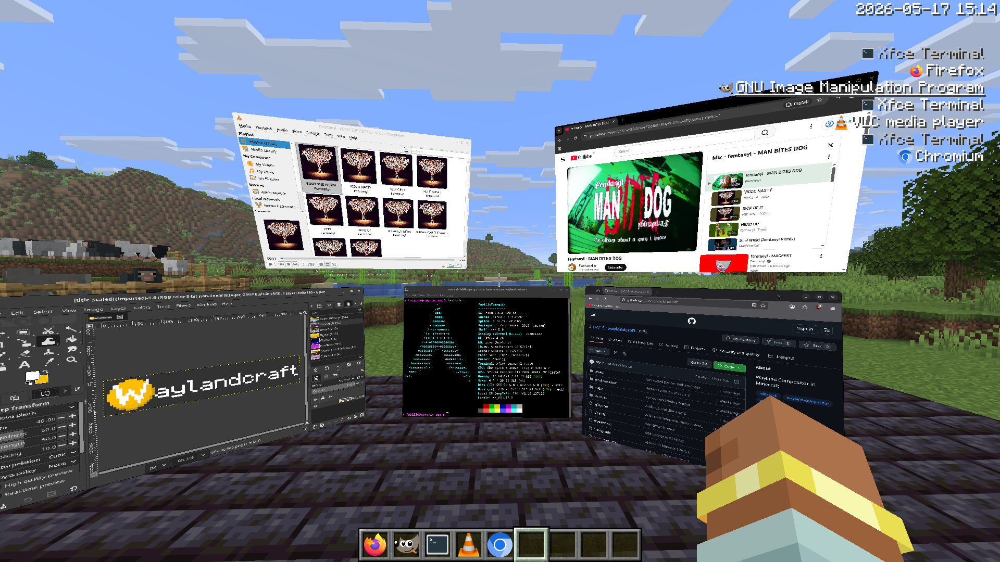

Wayland Compositor in Minecraft

[Demo video](https://youtu.be/cTkEM7b0IQw)

Now available on [Modrinth](https://modrinth.com/mod/waylandcraft)!

> **This repository is a personal fork of [WaylandCraft](https://github.com/EVV1E/waylandcraft)
> v2.0.3 by EVV1E**, published under the same GPL-3.0 license. It is not an
> official release and is not affiliated with the upstream author.

## Changes in this fork

### 1. HiDPI output scale (`WAYLANDCRAFT_SCALE`)

Upstream hard-codes the virtual output's `wl_output.scale` to 1, so on a
HiDPI host every app inside the compositor renders at a tiny logical
scale. This fork adds an environment variable read by the native library:

```sh
WAYLANDCRAFT_SCALE=2   # integer 1–8, default 1
```

It must be visible to the game JVM (it is read inside the native library
loaded by Minecraft). Changes:

- `native/src/output.rs` — sets `output.scale(N)`, actually pushes outputs
  into the `outputs` list on bind (upstream never did, so mode updates were
  never sent), and sends `wl_surface.enter` + `preferred_buffer_scale` on
  new surfaces (GTK/Qt need `enter` to honor output scaling).
- `native/src/scale.rs` (new) — reads the variable once, provides
  `px_to_logical()` and per-surface `buffer_scale` helpers.
- `native/src/bridge.rs` — configure sizes, xdg geometry, viewport
  destination, surface damage, popup offsets, input regions and DND
  coordinates are converted per-surface using that surface's own
  `buffer_scale`.
- `native/src/seat.rs` — pointer enter/motion/relative-motion converted from
  buffer to surface-local pixels using the focused surface's `buffer_scale`.

Limitations: `wl_output.scale` is integer-only, so 1.75 cannot be expressed
(use 2). Apps that ignore `buffer_scale` simply stay the same size. X11 apps
via xwayland-satellite depend on the satellite.

### 2. Fix: resizing a toplevel was capped at area/scale

`toplevel_resize` / `toplevel_resize_ovr` received widths and heights that
were *already* in surface-local (logical) pixels — both the C window manager
screen and the in-world resize grab pass logical sizes — but divided them by
the output scale again. With `WAYLANDCRAFT_SCALE=2` a window could therefore
only reach half of the available area (a quarter at 4×). The conversion is
removed; the call sites that really do get physical pixels (`toplevel_maximize`,
`output_resize`, `output_set_bounds`, `toplevel_fullscreen`) still convert.

### 3. Desktop-ish C window manager screen

`gui/WindowManagerScreen.java` gains:

- **Overview** — grid of live thumbnails of every window; click one to focus
  it; `Esc` or the button again exits.
- **Fill** — resizes the focused window to fill the C screen area. The
  logical size is computed from `framebuffer width / geometry width`, so it
  works for both HiDPI-aware and scale-ignoring apps.
- A small clock in the bottom-right corner.

## System dependencies
- OS: Linux
- Minecraft 26.1.2
- Fabric mod loader
- xkbcommon library 1.11.0
- xkbcommon tools (xkbcli)
- xwayland-satellite (for Xwayland support)

Additionally recommended:
- Prism Launcher
- Sodium

## Important notes for installing / using!!!
1. Do not use a Minecraft launcher packaged as a flatpak! You won't be able to use your apps.
2. For nvidia: Set the `__GL_THREADED_OPTIMIZATIONS` environment variable to `0` in your launcher.
3. The Zink OpenGL driver has been known to cause issues. Use native OpenGL instead.

## Frequently Asked Questions
### How do I use this thing?
Download the mod from the releases section, install Minecraft Fabric for 26.1.2 and drag the jar file in your mods folder.
Look at your keybind settings. By default `V` opens the app launcher, `G` enables keyboard capture allowing you to type in
the windows, `B` opens the window manager screen.

### How can I press Escape in the windows?
Instead of using `G` to capture the keyboard, use `ALT+Q` instead. The only way to turn it off is to press `ALT-Q` again,
so the `ESC` key is forwarded to the application.

### How do I run X11 apps?
Since v2.0.0 waylandcraft has integrated support for [xwayland-satellite](https://github.com/Supreeeme/xwayland-satellite).
If you have the binary installed on your system, it should automatically be started.

### How to do the relative mouse movement thing for 3D games?
Move your mouse over the window, then activate the hard keyboard capture mode. (`ALT-Q`)
Exiting the hard keyboard capture mode releases the mouse.

### Will there be multiplayer support?
Multiplayer support would require video streaming, a bunch of networking code and a rewrite of input handling,
so it's not really planned right now.

### But can I use it on a server though?
You can, but because it's a client-side mod, other players won't see your windows or be able to interact with them.
Servers can opt to install the mod, which will allow players to use the window items for themselves.
If the server doesn't support it, you can spawn a window in the world by going into the wm screen (default bind `B`)
and then pressing and holding the "Grab" button.

### Does this work in VR?
Depending on your VR mod, you can probably get the windows to display fine but you probably won't be able to interact with
the windows using your controller. Soooo, kinda.

### Does this work with shaders?
Since v2.0.2 Iris shaders are supported.

There are a couple of downsides though: The windows might have large borders and text in windows will be harder to read from a distance (because window anti-aliasing doesn't work)

This is because for the shader support windows are rendered with the same pipeline as entities because otherwise the shaders would ignore them.

For some shaders you might need to disable features like Temporal Anti Aliasing (TAA).

## Building and Running
You need a Rust development environment and a Java 25 SDK.
```sh
./build.sh #all arguments are passed to cargo build
```

The final jar file will be in `build/libs`, or run `./gradlew runClient`
for a development environment

Note that the `jar` task only bundles native libraries from
`native/target/debug/libwaylandcraft.so` (host build) or
`native-libs/libwaylandcraft-<target>.so` (release layout), so build the
native library before Gradle or the jar will contain no native code. The jar
task itself does not produce a ready-to-install jar for a release build; the
`.so` files have to be injected with `jar uf`.

This fork's `gradle.properties` also points Loom at mirrors
(`loom_fabric_repository`, `loom_libraries_base`, `loom_version_manifests`)
because the official Fabric maven was severely rate-limited on the network
where it was built. Remove those three lines to use the official sources.


## Images


## Disclaimer
This compositor still has lots of issues and bugs. Use it at your own risk or whatever.

## Contribution Policy
All contributions have to be made an accordance with the GPLv3 license (see `LICENSE`).
Waylandcraft has some important policy around LLMs and generative AI, mostly because of code and contribution quality as well as some ethical and copyright concerns.
Mergeable contributions made to the repository in the form of pull requests need to be made **without major usage** of LLMs.

If you feel as though you have something worthwhile to contribute which was made using LLMs **please disclose it** and file it as a **draft** pull request instead.
It will probably have to be more closely examined or even entirely rewritten by a human programmer, which can then be (re-)submitted as a normal pull request.
